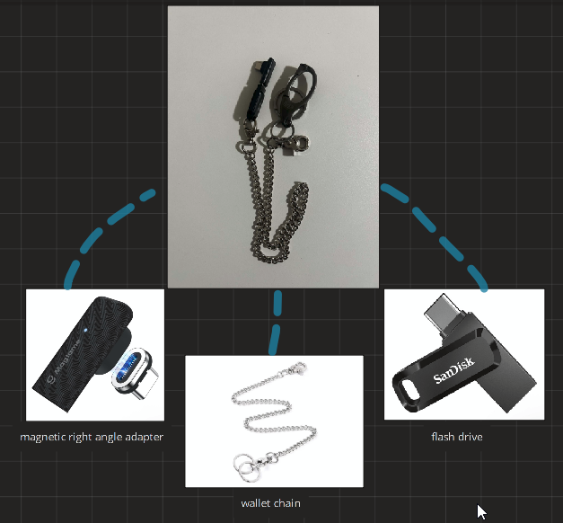

# BUSSKILL
This is a lightweight tool that locks your Windows PC whenever a specific USB flash drive is disconnected using simple PowerShell scripts and a scheduled task.

Once the configured drive is connected to the device with the scheduled task, the task is thus triggered and the powershell script is armed. Whenever, the drive is removed, the script requests a Windows lock, similar to when you press Win + L. Your applications stay running in the background even though you PC is now locked.

You can modify the script to request a shutdown, or a complete wiping of your PC.

## About
This project explores a USB device detection system, utilizing Windows automation and powershell scripting. At first, It started with putting a PC to sleep on removal of a specific USB, as a proof of concept, and later got updated to lock the PC instead.

## Inspiration
This project was heavily inspired by Proton Privacy’s YouTube video, [“Seven Gadgets a Security Expert Actually Uses”](https://youtu.be/WfVPjNAbkNY?si=YrIvuY2vHf2jZQQH), which sparked my interest in building a USB-triggered security tool, BUSSkill sounds cooler, of my own.

While researching possible resources for implementation, I found [Neil Brown’s guide to implementing BusKill on Debian 11](https://neilzone.co.uk/2022/01/implementing-buskill-shutting-down-a-debian-11-bullseye-machine-when-a-specific-usb-device-is-removed/). Although the guide provided a useful starting point at first, its software setup was specific to Linux distro, Debian 11. Since i use Windows, unfortunately, I scoured the internet to find resource for implementation of similar functionality using PowerShell.

This repository documents my the steps i took, setup instructions, and troubleshooting process for creating a Windows-based tool that responds to the removal of a designated USB device. Another way, an easier way, is to download the software from [Buskill's](https://github.com/BusKill/buskill-app) github repo. 

## Features
- Monitors a specific device using its Plug and Play device ID.
- Arms automatically whenever the configured drive is detected.
- Requests a Windows sleep/shutdown/lock when that specific drive is removed.
- Rearms when the drive is reconnected.
- Includes a test mode for checking detection using shell without locking.
- Can run in the background through Windows Task Scheduler.

## Hardware Requirements


- USB flash drive ( low storage capacity option preferred )
- magnetic USB adapter
- wallet chain of your preference
- Carabiner ( optional )

## Software Requirements
- Windows 10 or 11
- Windows PowerShell
- A windows admin account with a password, PIN, or other sign-in method.

## Getting Started with it

### 1. Download the project
You can clone this repo or download it as a ZIP file and extract it.

the commands below assume that the script you've downloaded is saved in this file format src/BUSSKill.ps1 and powershell is open in the repository's root folder.

### 2. Identify your USB drive ID
When you connect the flash drive to your PC, run this command in your powershell:
```powershell
Get-CimInstance Win32_DiskDrive |
    Format-List Model, InterfaceType, Size, PNPDeviceID
```

Identify your flash drive by its model and size. Copy its complete PNPDeviceID and paste it on an empty notepad page for later use.

### 3. Configure the script
Open src/BUSSKill.ps1 and replace the device ID placeholder with your deviceID that you had copied in that empty notepad page. 

```powershell
$targetId = 'YOUR_USB_DEVICE_ID'
```
make sure to keep the id value within the single quotes and preserve it's backslashes.

Then start with test mode enabled:
```powershell
$testOnly = $true
```

### 4. Test Detection
Run: 
``` powershell
powershell.exe -NoProfile -ExecutionPolicy Bypass -File ".\src\BUSSkill.ps1"
```

with the drive connected, wait for:
``` Plain text
ARMED: USB drive detected.
```
unplug the drive. In test mode, the script will print a removal message without locking your PC.
Then reconnect the drive to confirm that it rearms.
Press Ctrl + C to stop monitoring.

### 5. Enable locking
Change the configuration to:
```powershell
$testOnly = $false
```
After that, save the script file and restart the script. Connect the drive, wait for it to arm, and unplug it to test locking. 

**Changes to the file only take effect after restarting the script.**


## Working Mechanism
1. The script check connected drives and compares the `PNPDeviceID` values with the configured ID.
2. Matching drive arms the monitor.
3. If an armed drive disappears, the script disarms and call the Windows `LockWorkStation()` function.
4. The monitor continues running and waits for the drive to reconnect.

The polling loop pauses for 500 millisecond, around half a second, between checks. Actual detection time also depends on Windows device updates and query executions. Reconnecting the drive only rearms monitoring, it does not unlock the PC.
